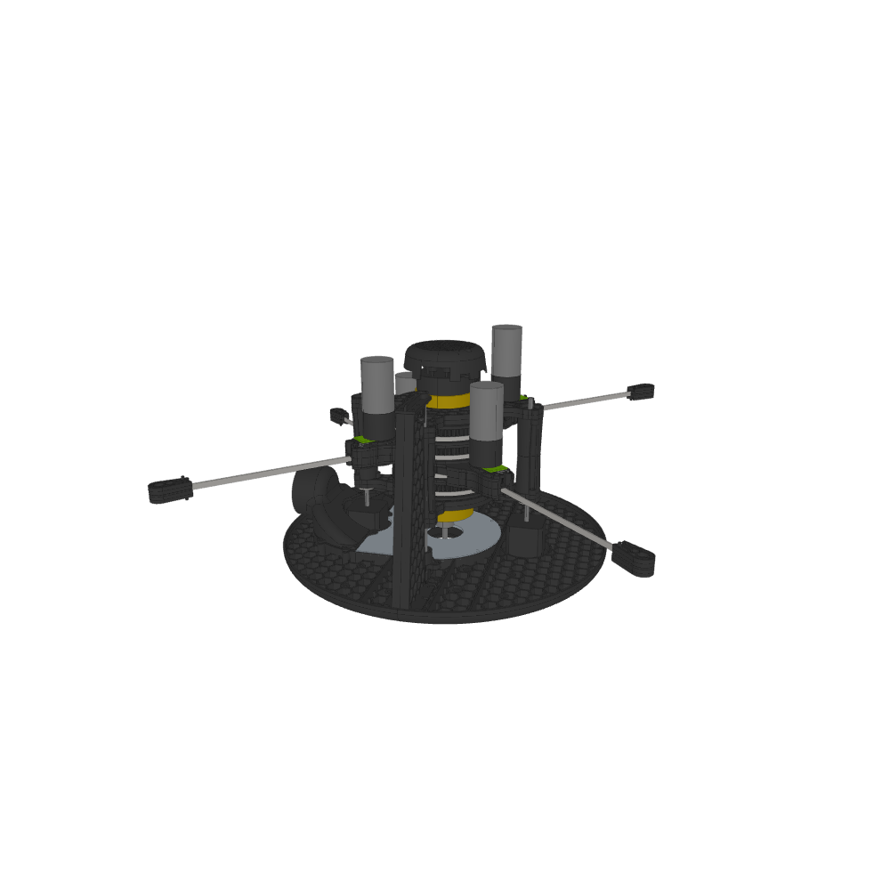

###### Note: Do not edit this file directly, it is automatically generated from the CAD model

# Maslow_4_Assembly

 ### Sled Assembly

### Dust Hose Adapter Options

## Dust hose adapter options

The machine above uses the 2.5 in adapter. These are the other sizes from the Maslow4 repository (1.25 in, 1.5 in, 2 in, 2.31 in, 4 in and 40 mm Festool), lined up side by side. Each has an Export atom so it can be downloaded as a STEP file and printed.

__GEOMETRY_INPUT__

# Maslow 4.1 Assembly

A complete 3D assembly of the [Maslow 4.1](https://www.maslowcnc.com) CNC router, built to show how the machine goes together and what every part is. The printed and molded parts are the official STEP files from [MaslowCNC/Maslow4](https://github.com/MaslowCNC/Maslow4), loaded unmodified straight from that repository.

## How the project is organized

- **Sled Assembly**: the sled, the acrylic dust cover, the 2.5 in dust hose adapter, the two Z axis stepper motors with their lead screws and built-in cables, and the two linear rod towers (linear rod, rod clamp, support riser and riser top). The other dust hose adapter sizes are in *Dust Hose Adapter Options*.
- **Router Assembly**: the DeWalt DWP611 router held by two Router Clamps (each with its clamp wedge), the four uprights (two Inner Posts each, with linear bearings riding on the rods), the stack of four Arms, the Controller and the Arm Cables. The Controller is the PCB holder, the 84 mm JST-XH 5 Axis Control Board (its connectors, and the ESP32 module underneath), the cable plugs in its connectors, the cooling fan and the PCB cover, which sits on the board. Change the Move at the end of this molecule to raise or lower the router along the Z axis.
- **Arm** (used four times): two Arm Halves around the Belt and Spool, the drive motor with its leads, the encoder board and its cable plug, drive and idler gears, the two belt rollers (one carries the encoder magnet), the belt guard, the belt and the two-piece belt end. The arms are stacked in the order shown in the assembly guide.
- **Power Supply**, with the gland its DC cable leaves through.
- **Power Cable** and **Z Motor Cables**: the cables that run from the router down to the power supply and the Z steppers.

## Wiring

Every cable is a [Wire_Between_Points](https://github.com/BarbourSmith/Wire_Between_Points) molecule: a round wire swept along a smooth curve from one circular edge to another, as thick as the circle it starts from.

- **Arm Cables**: each arm has an encoder cable from the JST-XH plug on its encoder board to a 5-pin encoder socket, and a red and a black wire from the top of its motor to a 2-pin motor socket.
- **Power Cable**: the power supply's DC cable to the XT60 socket.
- **Z Motor Cables**: each Z stepper's cable is built into the motor. It leaves the side of the motor, runs straight up beside it, and plugs into a 4-pin JST-PH stepper socket at the edge of the board (U11 and U8). The two 4-pin XH headers in the middle of the board are the AUX and serial ports.

The connector positions on the control board come from its Gerber files and schematic in [MaslowCNC/Boards](https://github.com/MaslowCNC/Boards). Each cable's ends are picked with *selected.EdgesByShape*: the tiny cube placed by the Move atom beside each picker marks the circular edge (the rim of a cable stub) the wire starts or ends at. Move the cube to re-route a cable, or remove the picker and use **Select Edges** on the wire's input to pick the edge by hand. Stiffness, Flip Start and Flip End on each wire shape its curve.

## Downloads

Every part that comes from the Maslow4 repository has an Export atom, so in Run mode each one can be downloaded as a STEP file (Arm, Belt End, Belt Guard, Belt Roller, Clamp, Clamp Wedge, Dust Cover, all seven Dust Hose adapters, Inner Post, Linear Rods Clamp, PCB Cover, PCB Holder, Post Support, Post Top, Sled and Spool).

Motors, gears, bearings, rods, circuit boards, connectors, cables, the fan, the router and the M3 fasteners are simplified stand-ins, not manufacturer models.

## Bill of materials

Each purchased part has a BOM tag that links to its page on [shop.maslowcnc.com](https://shop.maslowcnc.com). Parts sold in bags or packs are priced per piece. All of the nuts and bolts come in the Hardware Bag. A DeWalt DWP611 router (D26200 in 240 V regions) is needed but is not included in the kit.

## Building one

Step-by-step instructions are in the [Maslow assembly guide](https://www.maslowcnc.com/assembly-guide). The CAD files are released under the CC BY-SA 4.0 license.

__GEOMETRY_INPUT__

